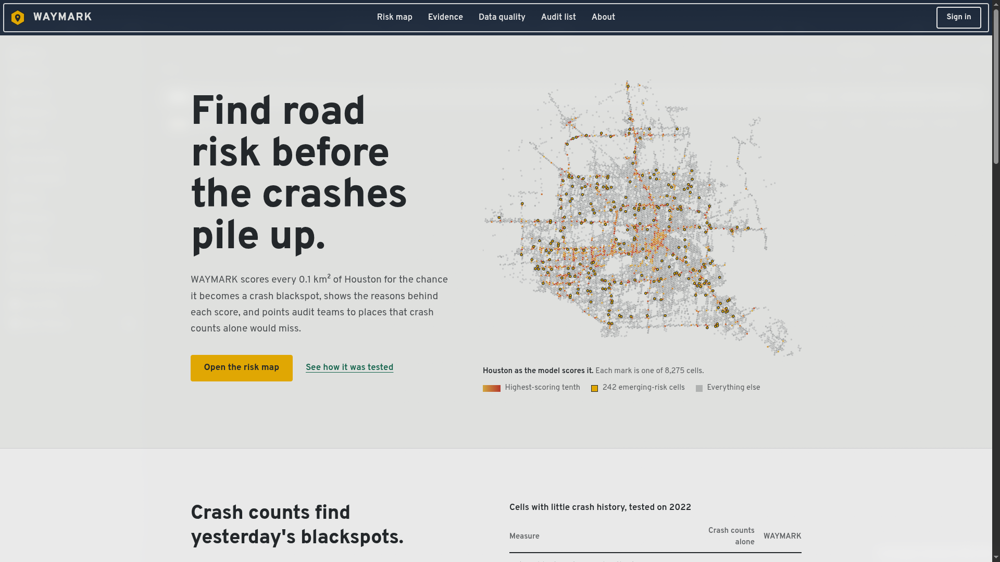
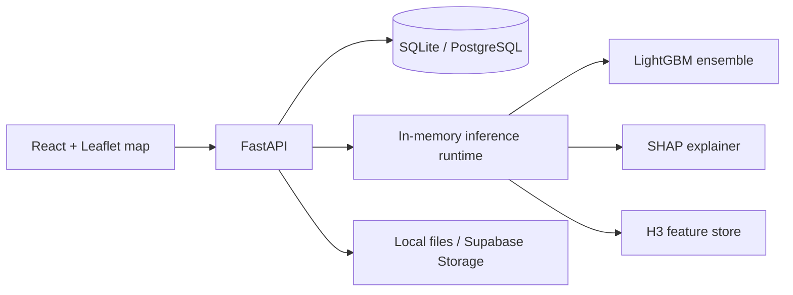

<div align="center">

# WAYMARK

### Predictive safety intelligence for safer streets

Explore road-risk patterns, understand the signals behind each score, and help teams prioritize locations for human review.

[](https://waymark-annb.onrender.com)
[](https://github.com/c-varshith/waymark)


[Screenshots](#screenshots) · [Features](#features) · [Quick start](#quick-start) · [Architecture](#architecture) · [Model and data](#model-and-data) · [FAQ](#frequently-asked-questions) · [API](#api) · [Responsible use](#limitations-and-responsible-use)

</div>

> **Decision support only.** WAYMARK helps identify places that may merit investigation. Scores are estimates from historical records—not crash forecasts, causal findings, or engineering determinations. People make the final decisions.

## Overview

WAYMARK divides the Houston study area into H3 hexagonal cells of roughly 0.1 km² and assigns each cell a 0–100 relative risk score. The interface brings the map, model evidence, what-if scenarios, incident reports, and human-reviewed safety measures into one workspace.

The project is a predictive safety intelligence layer: it is designed to support analysis alongside existing mapping and transportation tools, rather than replace them.

## Screenshots

<p align="center">
  
  
</p>

| At a glance | Details |
| --- | --- |
| Pilot city | Houston, Texas |
| Spatial grid | H3 resolution 9 |
| Model | Packaged three-model LightGBM ensemble with SHAP explanations |
| Backend | FastAPI, SQLAlchemy, SQLite for local development; PostgreSQL supported |
| Frontend | React, TypeScript, Vite, Leaflet, and H3 |
| Map tiles | OpenStreetMap by default; optional MapTiler styles |
| Assistant | Optional Groq or Anthropic integration, with a rule-based fallback |

## Features

- **Explore risk cells:** browse H3 scores, crash history, confidence, and emerging-risk locations on the interactive map.
- **Understand a score:** inspect SHAP contributors and supporting historical factors for a selected cell.
- **Compare scenarios:** explore night, rain, and low-visibility inputs. These are simulations, not live weather forecasts.
- **Review model evidence:** inspect backtest metrics, robustness comparisons, and data-quality checks with their caveats.
- **Prioritize field work:** search and export the emerging-risk audit list; generate region reports with PDF and JSON downloads.
- **Track safety measures:** record implementation progress, attach evidence, and request planner review. Adjusted scores and progress projections are illustrative overlays; they do not retrain or rerun the model.
- **Report incidents:** submit crash or near-miss reports for review. The live inference API returns a separate, capped incident overlay; it does not alter the trained model score.
- **View live traffic:** display cached TomTom congestion with attribution. An optional experimental congestion adjustment can affect Live scores only when a licensed historical traffic archive passes held-out validation and `WAYMARK_TRAFFIC_LIFT=1` is explicitly enabled; it is off by default and never changes Baseline scores. Live TomTom readings are not stored as training history. See [`docs/traffic_lift.md`](docs/traffic_lift.md).
- **Ask questions:** use the optional report-aware assistant for structured suggestions and discussion.

## Quick start

### Requirements

- Python 3.11 or later
- Node.js 20 or later and npm
- The packaged model files in `backend/ml_artifacts/` and feature store in `out/`

### 1. Set up the backend

From the project root:

```bash
python3 -m venv .venv
source .venv/bin/activate
python -m pip install --upgrade pip
python -m pip install -r backend/requirements.txt
```

On Windows PowerShell, activate the environment with `.venv\Scripts\Activate.ps1`.

Copy the root environment example and set a private, stable JWT secret for your local environment:

```bash
cp .env.example .env
```

The local SQLite database is intentionally excluded from Git because it can contain account and operational data. Create a development database from the included exports with:

```bash
python pipeline/load_db.py
```

The command stops if `waymark.db` already exists. Review [`pipeline/load_db.py`](pipeline/load_db.py) and its `--help` output before rebuilding; `--force` deletes the existing database and its operational data.

Start the API from the project root:

```bash
.venv/bin/uvicorn backend.main:app --reload
```

The API runs at <http://127.0.0.1:8000>. Interactive documentation is available at <http://127.0.0.1:8000/docs>.

### 2. Set up the frontend

In a second terminal:

```bash
cd frontend
npm ci
cp .env.example .env.local
npm run dev
```

Open <http://localhost:5173>. In local development, Vite proxies `/api` requests to the backend at `127.0.0.1:8000`.

The default map uses OpenStreetMap and does not need an API key. To use MapTiler, set `VITE_TILE_PROVIDER=maptiler` and a restricted browser key in `frontend/.env.local`. Keep all assistant and database credentials on the backend.

## Architecture



### Repository layout

| Path | Purpose |
| --- | --- |
| `frontend/` | React application, map, landing page, and API client |
| `backend/` | FastAPI routes, inference runtime, authentication, reports, measures, and evidence workflows |
| `backend/ml_artifacts/` | Packaged LightGBM models, SHAP explainer, and feature schema |
| `pipeline/` | Data validation, exports, database loading, and supporting ingestion utilities |
| `blackspot_pipeline.py` | Feature engineering, training, and model evaluation pipeline |
| `out/` | Generated feature store, scores, evaluation outputs, and pipeline exports |
| `supabase/` | SQL schema and versioned database migrations |
| `contracts/` | API contract examples and snapshots |
| `docs/` | Realtime inference changelog and manual verification steps |
| `data/` | Runtime report and evidence files in local development |

For frontend-specific routes and behavior, see [`frontend/README.md`](frontend/README.md).

## Model and data

The packaged model was trained using the US Accidents dataset (2016–2023), attributed to Sobhan Moosavi and collaborators. The raw source dataset is not included. Review the original dataset's terms and confirm provenance before redistributing or using derived data operationally.

At startup, FastAPI loads the packaged LightGBM ensemble, SHAP explainer, feature schema, and H3 feature store into memory. The inference API supports single-cell scoring and batch scoring with optional scenario overrides. It does not update model weights during requests.

- `risk_probability` is the model's positive-class probability.
- `risk_score` is the probability's percentile against the saved reference distribution, on a 0–100 scale. It is **not calibrated** and should not be interpreted as a percentage chance of a crash.
- Single-cell inference includes SHAP contributors. Batch inference omits SHAP for speed.
- Scenario overrides change selected model inputs; they are not live weather observations.
- Incident overlays are separate from model predictions: active crash reports add 20 points and near-miss reports add 10, capped at 100. The overlay is process-local and intended for a single API worker; persisted reports rebuild it at startup.

The data and model are Houston-specific. Review the evidence and quality pages before interpreting the map. For the current inference performance results and manual checks, see [`docs/CHANGELOG-realtime.md`](docs/CHANGELOG-realtime.md) and [`docs/manual-checks/phase-1.md`](docs/manual-checks/phase-1.md).

## Frequently asked questions

### Why use the US Accidents dataset?

It provides a large historical set of crash records with locations, timestamps, and related conditions. Those fields support the project's core workflow: grouping crashes into map cells, engineering features, and evaluating scores against later historical outcomes. The project uses the Houston-area subset for its pilot. The dataset is not a complete or authoritative record of every crash; reporting coverage, missing values, and collection practices can affect what it represents. See the [dataset and attribution notes](#model-and-data).

### Why Houston?

Houston is the current pilot area for building and evaluating the full mapping and inference workflow in one place. The model artifacts and cell feature store are Houston-specific. A different city needs suitable local data, new feature generation, and its own evaluation before its scores should be used.

### Why use H3 hexagons?

H3 gives the app consistent cell IDs and a regular grid for aggregating crash history and displaying scores. The current grid uses resolution 9, with cells averaging roughly 0.1 km². The hexagons are an analysis unit; they do not imply that risk is uniform across every street inside a cell.

### Why include simulations?

The rain, night, and low-visibility controls let someone compare how selected model inputs affect a cell's score. They are controlled what-if scenarios, not a forecast or a claim about current conditions. A simulation should be read as “what the model returns with these inputs,” not “what will happen on this road.”

### Why is the score 0–100 instead of a crash probability?

The displayed score ranks a model probability against a saved reference distribution. It is useful for comparing cells in this project, but it is not calibrated as a percentage chance of a crash. The API's `risk_probability` is also a model output, not a validated individual-road forecast. See [Model and data](#model-and-data).

### Why LightGBM and SHAP?

LightGBM is used to score the project's structured, tabular cell features efficiently. SHAP provides a breakdown of which model inputs contributed to a selected cell's output. These contributions describe the model's calculation; they do not establish that a factor caused crashes or that changing it will prevent them.

### What does “Live” mode update?

Live mode reads cached provider context and reports its freshness or availability. By default, weather conditions are explanatory context and do not change the model ranking. Incident reports are shown as a separate, decaying overlay; they do not retrain the model. Experimental traffic scoring is disabled by default and requires a separately licensed historical traffic archive, a passing held-out validation, and explicit backend opt-in. Live provider readings are not saved as training history. See [`docs/traffic_lift.md`](docs/traffic_lift.md).

### Why not train continuously from reports or live traffic?

Changing model weights while people are using the map would make scores harder to reproduce and review. WAYMARK serves packaged model weights; incoming incident reports update a separate temporary overlay. Live traffic readings also cannot be treated as historical training data under the current provider terms review. Any future traffic effect must use a separately licensed archive and pass the documented validation gate.

### Can I use the current model for another city or operational decisions?

Not without additional work. The current feature store and evaluation are specific to Houston and the available historical records. This prototype is decision support for human review, not a substitute for local crash data, engineering judgment, or a safety assessment. See [Limitations and responsible use](#limitations-and-responsible-use).

## API

FastAPI's OpenAPI reference is available at `/docs` when the backend is running. Main route groups include:

| Area | Routes |
| --- | --- |
| Health | `GET /api/health`, `GET /api/health/model` |
| Cells and crash points | `GET /api/cells`, `GET /api/cells/{cell_id}`, `GET /api/crashes` |
| Live inference | `POST /api/predict`, `POST /api/predict/batch` |
| Scenarios and evidence | `GET /api/whatif`, `GET /api/metrics`, `GET /api/validation` |
| Reports and regions | `/api/reports`, `GET /api/regions/resolve`, `GET /api/places` |
| Incidents | `POST /api/incident`, `/api/incidents` |
| Measures and evidence files | `/api/measures`, `/api/evidence` |
| Assistant | `/api/chat/sessions` and session message routes |

Authenticated routes enforce role-based permissions. The API and schemas define the source of truth for each request and response.

## Configuration

Backend settings can be supplied as environment variables or in the root `.env` file. The main optional production integrations are:

| Setting | Purpose |
| --- | --- |
| `DATABASE_URL` | PostgreSQL connection string. Leave unset for local SQLite development. |
| `WAYMARK_JWT_SECRET` | Stable, private secret for signing authentication tokens. |
| `SUPABASE_URL`, `SUPABASE_SERVICE_ROLE_KEY` | Private backend access to Supabase Storage. Never expose the service-role key in frontend settings. |
| `GROQ_API_KEY` or `ANTHROPIC_API_KEY` | Optional assistant provider credentials. Without a provider, the app uses its rule-based fallback. |
| `WAYMARK_ML_ARTIFACT_DIR` | Model artifact directory; defaults to `backend/ml_artifacts/`. |
| `WAYMARK_ML_FEATURE_STORE` | H3 feature CSV; defaults to `out/cell_features.csv`. |
| `WAYMARK_DATA_DIR` | Local directory for generated reports and evidence files. |

See [`.env.example`](.env.example) and [`frontend/.env.example`](frontend/.env.example) for the full set of supported values. Do not commit secrets or production environment files.

## Data pipeline

The training and data preparation workflow is separate from online inference:

1. Run `blackspot_pipeline.py` with an authorized source dataset to engineer features, train/evaluate the model, and generate artifacts.
2. Validate and export database-ready outputs with the scripts in `pipeline/`.
3. Load the generated tables into a local database with `python pipeline/load_db.py` when building a fresh development dataset.

Use each script's `--help` output to review its inputs and write behavior. Back up the database and `data/` before performing data migrations or rebuilds. The app's live inference endpoints load fixed model weights and update scenario inputs or the process-local incident overlay only.

## Deployment

The intended deployment separates the React frontend (Vercel) from the FastAPI service (Render), with Supabase Postgres and private Supabase Storage for persistent production data.

- Deploy the frontend with `frontend/` as the root directory and `dist` as the output directory.
- Deploy the backend from the repository root with `uvicorn backend.main:app --host 0.0.0.0 --port $PORT`.
- Set `VITE_API_BASE` to the backend's public origin and configure the backend CORS allowlist to include the frontend origin.
- Set the database, storage, and JWT secrets in the backend's hosting environment. Never put server credentials in `VITE_*` variables.
- Apply the appropriate SQL migrations before connecting a production backend. Keep persistent database and file backups.

Refer to the [frontend deployment notes](frontend/README.md#build-preview-and-deployment) and the SQL files under [`supabase/`](supabase/) before deploying.

## Development checks

Run from the project root:

```bash
python -m pytest
cd frontend
npm run lint
npm run build
```

## Limitations and responsible use

- WAYMARK is a prototype for human decision support, not an automated audit, enforcement, or dispatch system.
- Results are based on one city and one historical dataset. Performance may not transfer to other regions, time periods, or reporting conditions.
- Crash records can contain missing fields, under-reporting, and changes in reporting practices. Review data-quality warnings and confidence information.
- Model associations do not prove causes, and suggested actions do not guarantee a safety improvement.
- Adjusted measure weights are placeholders until reviewed by a qualified road-safety domain owner.
- Assistant responses are suggestions for human review, not engineering, legal, or safety certification.

## Attribution

The crash data is derived from the US Accidents dataset (2016–2023), attributed to Sobhan Moosavi and collaborators. Map imagery may include OpenStreetMap contributors and optional third-party tile providers. Follow the applicable attribution and usage terms when deploying or redistributing the application.
